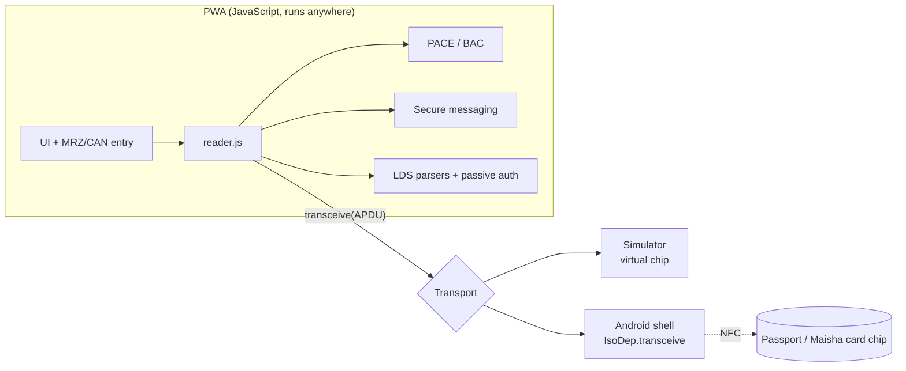

# Chip ID Reader

A PWA that reads the NFC chip in **ICAO 9303 travel and identity documents**: East African ePassports, the Kenyan **Maisha card**, and any other ePassport or eID card with an ICAO chip. It runs the full chip protocol (BAC, PACE, secure messaging, data-group parsing and passive authentication) in plain JavaScript. A ~200-line Android shell gives it the one thing browsers lack: raw access to the chip.

- **Try it without hardware:** the built-in simulator runs the real protocol against a virtual chip with fictional specimen data.
- **Read a real document:** install the Android shell (APK built by GitHub Actions) on an NFC phone.

---

## Which approach works?

Passport and ID chips are ISO 14443-4 smart cards. Reading one means:

1. **Access control.** A cryptographic handshake keyed from the MRZ (document number, date of birth, expiry) or the 6-digit CAN: **BAC** (3DES) on older documents, **PACE** (elliptic-curve Diffie-Hellman + AES) on newer ones. Many cards issued since about 2018 support PACE only.
2. **Secure messaging.** Every later command and response is encrypted and MACed with session keys.
3. **Reading data groups** (DG1 MRZ, DG2 photo, DG11/12 details) and checking them against the signed **EF.SOD**.

All of this needs **raw APDU exchange** (`IsoDep.transceive` on Android, `NFCISO7816Tag.sendCommand` on iOS).

| Option | Can it read a passport / Maisha chip? | Notes |
|---|---|---|
| **Web NFC** (`NDEFReader`, Chrome Android) | **No** | Only NDEF read/write. A passport looks like an empty tag. APDU `transceive()` was discussed in the W3C group and deferred. No support on iOS. |
| **WebToNative NFC add-on** (`WTN.NFC.status/read/write`) | **No** | Returns the tag's NDEF text content and writes NDEF. No ISO-DEP / APDU access. Useful for NFC stickers, not ID chips. |
| **Thin native shell + protocol in JS** *(this repo)* | **Yes** | The shell only forwards APDUs; the PWA does everything else. One codebase for web, simulator and app. You own all the code. |
| Capacitor / native app with JMRTD (Android) + NFCPassportReader (iOS) | Yes | Mature native libraries that also do Chip Authentication. More native code to maintain; logic split across two platforms. |
| Commercial SDKs (ReadID/Inverid, Regula, Innovatrics, …) | Yes | Fastest route to production: certified, include CSCA master lists, liveness and support. Paid per scan or per licence. |

**Recommendation.** For a demo or MVP, use this architecture: a PWA with the ICAO protocol in JavaScript plus a thin, origin-locked native NFC bridge. If you already use WebToNative to package the site, you would still need a custom native plugin that exposes `transceive` (their current NFC add-on doesn't). This repo's shell is that plugin, in its simplest form. For production KYC at scale, compare the cost of a commercial SDK with the cost of adding Chip Authentication, CSCA master-list handling and certification work to this code.

## Architecture



The transport interface is three methods: `connect()`, `transceive(Uint8Array) → Uint8Array`, `disconnect()`. Porting to iOS, Capacitor or a USB PC/SC reader means writing one more transport.

## What's implemented

| Area | Status |
|---|---|
| BAC (3DES) | ✅ checked against the ICAO 9303-11 Appendix D worked example |
| PACE ECDH Generic Mapping, MRZ or CAN password, 3DES/AES-128/192/256, all standard curves (NIST P-192…P-521, brainpool 192…512) | ✅ checked against the ICAO 9303-11 Appendix G worked example |
| Secure messaging 3DES + AES, extended/odd-INS reads | ✅ checked against Appendix D |
| EF.COM, DG1 (TD1/TD2/TD3 MRZ), DG2 face (JPEG/JPEG 2000), DG7, DG11, DG12, DG14/DG15 presence | ✅ |
| Passive authentication: DG hashes vs SOD, DS signature (ECDSA incl. brainpool and explicit curve params, RSA PKCS#1 v1.5, RSA-PSS), optional CSCA chain | ✅ |
| Simulator (virtual chip, two specimen documents, demo PKI) | ✅ |
| Android APDU bridge | ✅ code complete, built by CI; **not yet tested on a real Maisha card or passport** |
| PACE DH / Integrated Mapping / Chip-Authentication Mapping | ❌ falls back to BAC when possible |
| Chip Authentication / Active Authentication (anti-cloning) | ❌ detected and reported, not run |
| Displaying JPEG 2000 photos in Chrome | ❌ exported in JSON; needs a JP2 decoder |
| iOS shell | ❌ needs a Swift WKWebView shell with Core NFC (same JS contract) |

`npm test` runs 19 tests: crypto primitives against OpenSSL and RFC vectors, the ICAO worked examples, and end-to-end reads against the virtual chip (PACE-MRZ, PACE-CAN, BAC, wrong key, tampered data group).

> **About the Maisha card.** Public sources confirm it has an NFC chip and an ICAO-format MRZ. They don't say which access protocol the chip uses (BAC, PACE-GM, or a variant this demo doesn't implement yet) or which data groups are readable without terminal certificates. The simulator's "Maisha-style" card is an illustrative guess (PACE-only, AES-256). The first real test will tell you: the app's result panel lists the PACE options from the chip's EF.CardAccess, and the APDU log shows every exchange.

## Quick start

### 1. Run the PWA locally (simulator)

```bash
npm test                 # protocol test-suite (Node 20+)
node tools/serve.mjs     # http://localhost:8080
```

### 2. Host it over HTTPS (needed for PWA install and Web NFC)

Push to `main` and enable **Settings → Pages → Source: GitHub Actions**. `.github/workflows/pages.yml` publishes the app.

### 3. Get the Android app

1. Push the repository (any branch). The **Android APK** workflow builds `app-debug.apk`.
2. Open the workflow run in the **Actions** tab and download the `chip-id-reader-debug-apk` artifact.
3. Copy it to an NFC-capable Android phone (Android 7+) and install it (allow "install unknown apps").
4. Open **Chip ID Reader**, choose **Phone NFC**, enter the MRZ details or CAN, press **Read chip**, and hold the document flat against the back of the phone.

Or build locally with Android Studio: open the `android/` folder and run it.

By default the APK bundles the web app. To make the shell load your hosted PWA (so web updates ship without a new APK), run the workflow manually with `start_url`, or build with:

```bash
cd android && ./gradlew assembleDebug -PstartUrl=https://<you>.github.io/<repo>/
```

The NFC bridge is injected **only** into the bundled origin and that one URL's origin, never into other sites.

### 4. Single-file demo

```bash
npm install && npm run build:artifact   # → dist/chip-id-reader.html (self-contained, simulator)
```

## Reading tips

- **Where the antenna is:** usually in the upper back of the phone, near the camera. Passports: the chip is in the cover or in the polycarbonate data page; lay the open booklet on the phone.
- **Hold still** for the whole read. The photo (DG2) is 15-30 KB and takes a few seconds; untick "Read the facial image" for a fast check.
- **MRZ mistakes** cause `Authentication failed (SW 6300)`. Watch for O/0 and I/1. Paste the MRZ lines and the app validates the check digits for you.
- Phone cases with metal or magnets block NFC.

## Privacy and compliance

- All processing happens on the device. Nothing is uploaded. Results only leave the device if you export them.
- The app doesn't store MRZ data, CANs or chip contents. It remembers only the selected document type and any CSCA certificates you add.
- Reading someone's ID chip is processing personal (and, for the photo, biometric) data. In Kenya that falls under the **Data Protection Act, 2019**. Get informed consent, collect only what you need, and register with the ODPC if you deploy this for KYC.
- Fingerprints and iris (DG3/DG4) are protected by Extended Access Control and need terminal certificates from the issuing state. This app never attempts to read them.

## Project layout

```
index.html, styles.css, manifest.webmanifest, sw.js   PWA shell
js/app.js                     UI controller
js/icao/                      reader.js (orchestration), pace.js, bac.js, sm.js, card.js, lds.js, mrz.js, passive-auth.js, apdu.js
js/crypto/                    des.js, aes.js (+CMAC), hash.js, ec.js, curves.js (generated)
js/transports/                simulator.js, android-bridge.js, ndef-probe.js (Web NFC / WebToNative diagnostics)
js/sim/                       virtual-chip.js, sim-data.js (generated specimen documents)
android/                      Kotlin WebView shell (APDU bridge)
tools/                        generators (curves, specimen data + demo PKI, icons), dev server, single-file build
tests/                        node:test suites
```

Specimen documents are fictional and marked SPECIMEN. They are signed by a throwaway demo CSCA generated by `tools/build-sim-data.mjs`, which does not represent any real authority.
